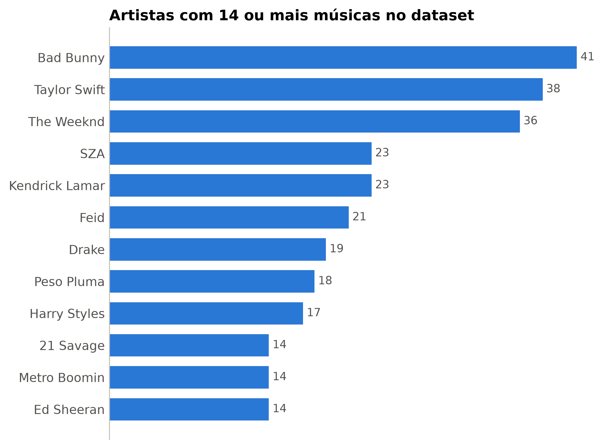
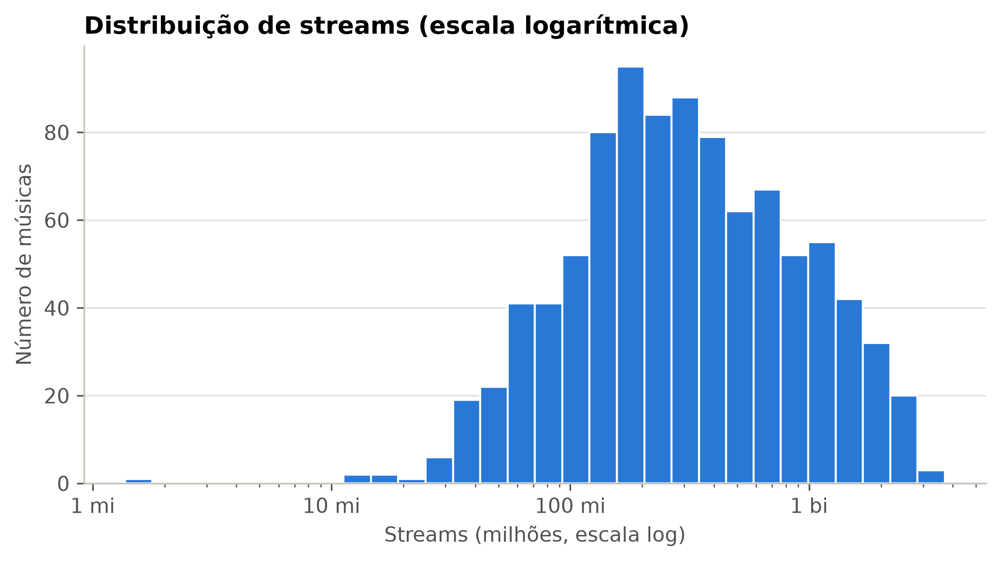
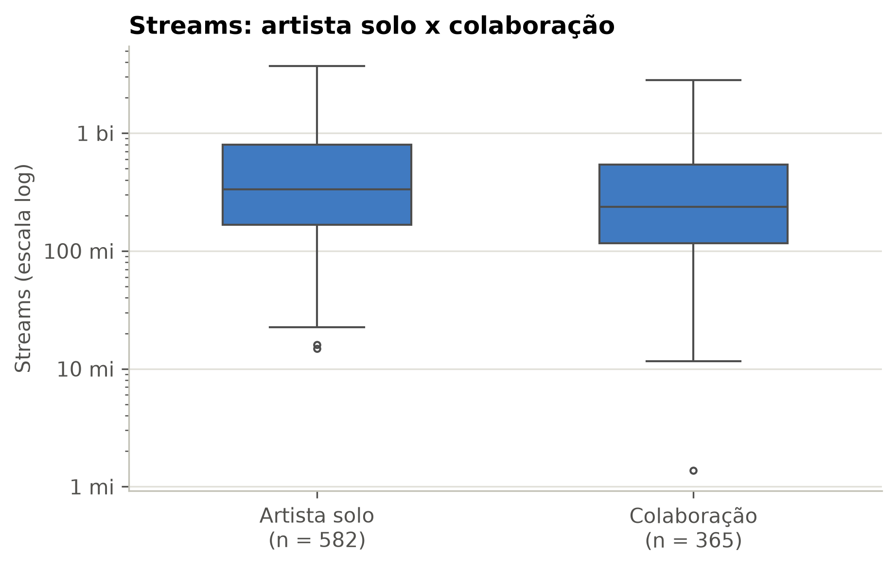
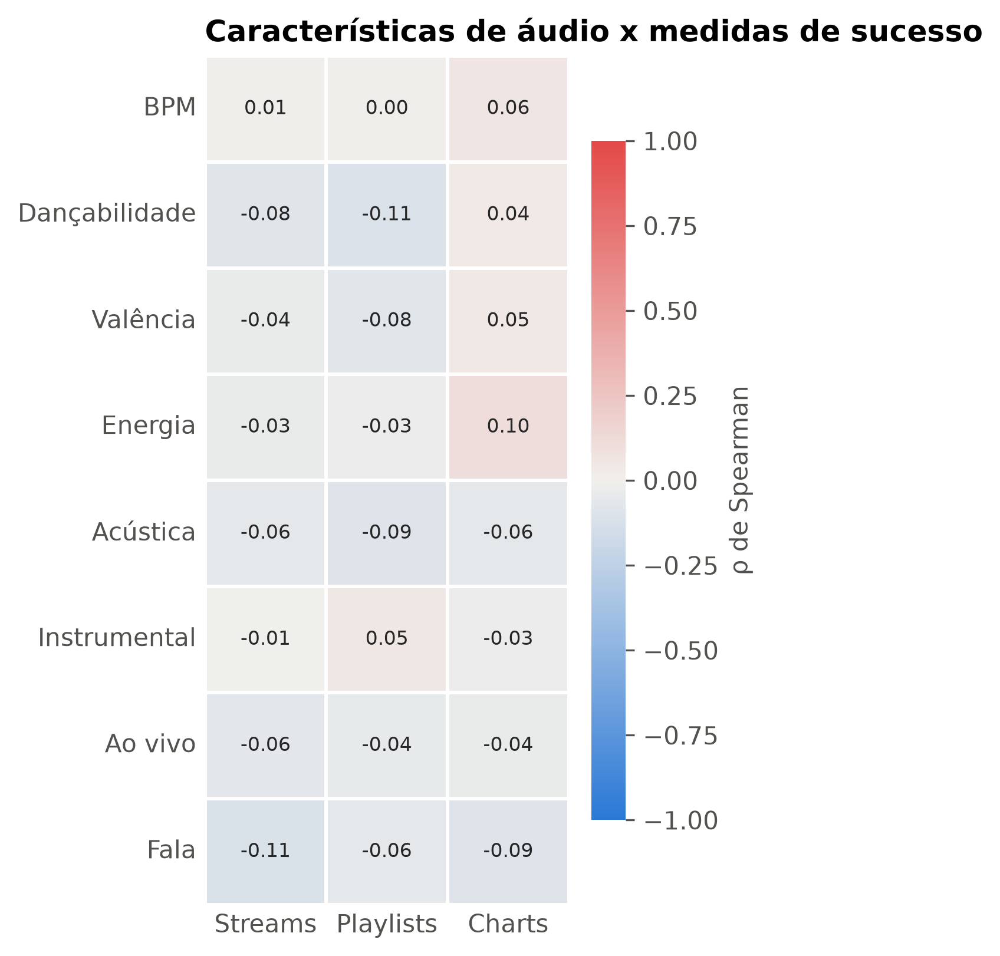
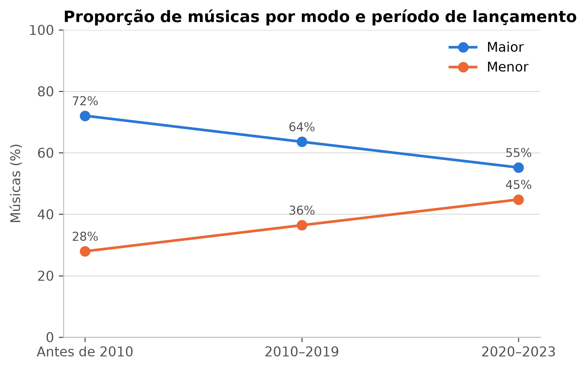

# O que faz uma música ser das mais ouvidas no Spotify?

Análise exploratória das **949 músicas mais ouvidas do Spotify em 2023**, investigando se características musicais (formato solo ou colaboração, modo, andamento, dançabilidade, energia etc.) estão associadas ao sucesso, medido por streams, presença em playlists e presença nos charts.

Projeto desenvolvido na disciplina **SSC0801 – Laboratório de Introdução à Ciência da Computação I** (ICMC – USP), em Python, com Pandas, NumPy, Matplotlib e Seaborn.

---

## Pergunta de pesquisa

> Quais características musicais estão associadas ao sucesso das músicas mais ouvidas do Spotify em 2023?

Quatro hipóteses exploratórias foram avaliadas de forma **descritiva** (mediana, quartis, boxplots e correlação de Spearman), sem testes de hipótese formais:

1. Colaborações têm mais streams que músicas de um só artista.
2. Músicas em tom maior têm mais streams que em tom menor.
3. O trimestre de lançamento está associado aos streams.
4. As características de áudio se correlacionam com as medidas de sucesso.

---

## Principais resultados

### 1. O dataset é concentrado em poucos artistas e em lançamentos recentes

Bad Bunny, Taylor Swift e The Weeknd somam 115 músicas (~12% do total), reflexo de lançamentos de álbuns que colocam várias faixas entre as mais ouvidas ao mesmo tempo. 77% das músicas foram lançadas a partir de 2020.



### 2. O sucesso é muito desigual

As três medidas de sucesso são fortemente assimétricas: metade das músicas tem entre 142 e 673 milhões de streams, mas algumas passam de 3 bilhões. Em escala logarítmica, a distribuição fica aproximadamente simétrica.



### 3. Colaborações não têm mais streams, e a diferença geral engana

No dataset completo, músicas de artista solo têm mediana de streams ~41% maior que colaborações. Comparando apenas músicas lançadas em 2022, essa vantagem cai para ~9%. A diferença geral vem da **composição do dataset**: as músicas antigas, que tiveram anos para acumular streams, são majoritariamente solo (79%), enquanto a partir de 2020 as colaborações chegam a 44%. Um exemplo de **variável de confusão**.



### 4. Não há uma "fórmula sonora" do sucesso nestes dados

Nenhuma característica de áudio apresentou mais do que associação fraca com o sucesso (|ρ| ≤ 0,1), resultado que se mantém com outro método de correlação. Como o dataset contém apenas sucessos, as características variam pouco entre as músicas (restrição de amplitude), e fatores externos ao áudio, como o artista e a época de lançamento, parecem pesar mais.



### 5. O perfil sonoro muda com a época de lançamento

Entre as músicas mais ouvidas em 2023, quanto mais recente o lançamento, menor a proporção em tom maior (72% antes de 2010 → 55% em 2020–2023), e as músicas mais recentes possuem maior taxa de dançabilidade.



### Resposta à pergunta de pesquisa

Neste dataset, **nenhuma característica musical analisada apresentou associação relevante com o sucesso**. As características descrevem bem o perfil das músicas mais ouvidas (dançantes, energéticas, pouco acústicas e cantadas) e mostram como esse perfil varia com a época, mas não diferenciam, entre os sucessos, os que são mais ouvidos dos que são menos.

---

## Limitações

- **Viés de seleção:** o dataset contém apenas músicas de sucesso, sem grupo de comparação.
- **Medidas acumuladas:** streams e playlists dependem do tempo desde o lançamento.
- **Análise descritiva:** sem testes de hipótese.
- **Qualidade dos dados:** nomes de artistas com caracteres perdidos e truncados na fonte e significado não documentado da coluna `in_spotify_charts`.

Todas as decisões de limpeza estão documentadas e justificadas nos notebooks.

---

## Etapas do projeto

| Notebook | Conteúdo |
|---|---|
| [`01_inspecao_inicial.ipynb`](notebooks/01_inspecao_inicial.ipynb) | Diagnóstico dos problemas do dataset: codificação, valores faltantes, tipos incorretos, duplicatas e datas suspeitas |
| [`02_selecao_e_limpeza.ipynb`](notebooks/02_selecao_e_limpeza.ipynb) | Seleção das colunas e limpeza com funções documentadas e testadas, mostrando o antes e o depois de cada etapa |
| [`03_analise_descritiva.ipynb`](notebooks/03_analise_descritiva.ipynb) | Perfil do dataset, distribuições, comparações por grupo, correlação e conclusões |

Destaques da limpeza:

- Os 95 valores faltantes de tonalidade correspondiam à nota C (provável erro na conversão dos dados), hipótese verificada externamente em uma amostra aleatória.
- Dois valores de streams com erro de coleta foram invalidados, mantendo as demais informações das músicas.
- Quatro músicas duplicadas foram tratadas com uma regra única e reproduzível.

As funções de limpeza, análise e visualização ficam em [`src/funcoes.py`](src/funcoes.py), cada uma documentada com propósito, parâmetros e retorno.

---

## Estrutura do repositório

```
spotify-streams-analysis/
├── data/
│   ├── spotify-2023.csv           # dataset original
│   └── spotify_2023_limpo.csv     # dataset limpo (gerado pelo notebook 02)
├── src/
│   └── funcoes.py                 # funções reutilizáveis
├── notebooks/                     # análise, na ordem de execução
├── figures/                       # gráficos exportados
├── artigo/                        # artigo final (PDF)
└── requirements.txt
```

---

## Como reproduzir

Requer Python 3.13 (ou próximo).

```bash
git clone https://github.com/SEU-USUARIO/spotify-streams-analysis.git
cd spotify-streams-analysis

python -m venv .venv
.venv\Scripts\activate          # Windows
# source .venv/bin/activate     # Linux / macOS

pip install -r requirements.txt
```

Depois, abra os notebooks da pasta `notebooks/` e execute-os **na ordem** (01, 02, 03). O notebook 02 gera o dataset limpo usado pelo 03.

---

## Dados

[Most Streamed Spotify Songs 2023](https://www.kaggle.com/datasets/nelgiriyewithana/top-spotify-songs-2023), de Nidula Elgiriyewithana, disponível no Kaggle. O arquivo original está em `data/spotify-2023.csv`, sem nenhuma edição manual.

---

## Autor

**CARLOS EDUARDO DE CAMPOS OLIVEIRA**: código, limpeza, análise e repositório.
[LinkedIn](www.linkedin.com/in/carlos-eduardo-de-campos-oliveira-27601b224) · [GitHub](https://github.com/CarlosEduardodeCamposOliveira)